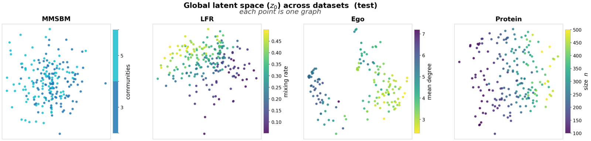
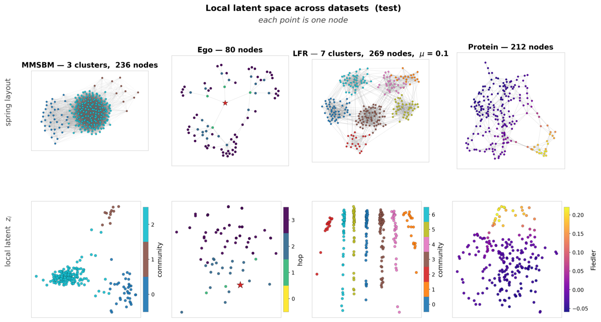
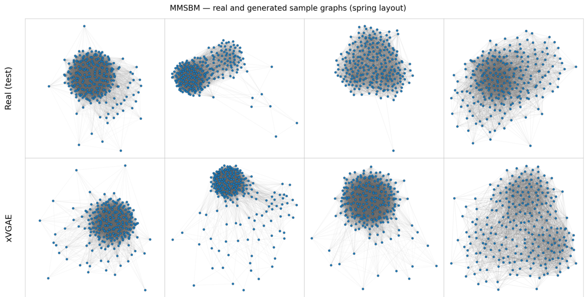

# xVGAE: A Hierarchical Variational Graph Autoencoder for Exchangeable Graphs

Daniele Micheletti, Federica Zoe Ricci, Erik B. Sudderth · NeurIPS 2026 · [arXiv:2610.30815](https://arxiv.org/abs/2610.30815)

xVGAE is a variational autoencoder for graphs whose latent structure follows the Aldous–Hoover representation of
exchangeable graphs. Each graph has a global latent $z_0$ and one latent $z_i$ per node:

$$z_0 \sim p_\theta(z_0), \qquad z_i \mid z_0 \overset{\text{iid}}{\sim} p_\theta(z_i \mid z_0), \qquad A_{ij} \mid z, z_0 \sim \mathrm{Bernoulli}\big(\omega_{ij}(z, z_0)\big),$$

with $z = (z_1, \dots, z_n)$. The prior on $z_0$ is a latent diffusion model (DDPM). The decoder is either set-attention
layers over all nodes (xVGAE-SAB) or a pointwise MLP on $(z_0, z_i)$ (xVGAE-MLP).

<p align="center"></p>
<p align="center"><em>The global latent z<sub>0</sub> (PCA, one point per test graph) embeds structural information of the graphs.</em></p>

<p align="center"></p>
<p align="center"><em>Node latents z<sub>i</sub> of one test graph per dataset, coloured by community, hop or Fiedler value.</em></p>

## Install

Install PyTorch with Python 3.10. This is the CPU build; for a GPU use `--index-url https://download.pytorch.org/whl/cu128`.

```bash
pip install torch==2.11.0 --index-url https://download.pytorch.org/whl/cpu
```

Install the package and its dependencies.

```bash
pip install -r requirements.txt && pip install -e . --no-deps
```

Build ORCA, used for the orbit statistic.

```bash
bash scripts/build_orca.sh
```

## Train and generate

The steps use MMSBM and the xVGAE-MLP configuration. The other datasets and decoders run the same way
([Paper configurations](#paper-configurations)).

**1. Data.** Build the dataset. Its edges are checked against those used in the paper.

```bash
python scripts/make_data.py mmsbm_medium --out data
```

**2. Autoencoder.** Train the encoder, the node prior and the decoder.

```bash
python scripts/train_stage1.py --config configs/mmsbm_mlp.json --data data --run-dir runs/mmsbm_mlp
```

**3. Checkpoint.** Pick the autoencoder checkpoint on the validation graphs.

```bash
python scripts/select_stage1.py --run runs/mmsbm_mlp
```

**4. Prior on z<sub>0</sub>.** Train the diffusion model on the encoded global latents.

```bash
python scripts/train_z0_ddpm.py --run runs/mmsbm_mlp --out-dir runs/mmsbm_mlp/z0_ddpm
```

**5. Generate.** Sample $z_0$ from the diffusion model, then the node latents, then the edges.

```bash
python scripts/sample.py --run runs/mmsbm_mlp --ddpm-dir runs/mmsbm_mlp/z0_ddpm --out-dir samples/mmsbm_mlp
```

<p align="center"></p>
<p align="center"><em>MMSBM: real test graphs (top) and graphs generated by xVGAE (bottom).</em></p>

**6. Evaluate.** Compare the samples with the test graphs: MMD of degree, clustering, spectrum, orbit and WL statistics,
with kernel bandwidths fitted on the training graphs so that no statistic saturates, and a classifier two-sample test.

```bash
python scripts/score.py --name mmsbm_medium --data data --samples samples/mmsbm_mlp
```

## Your own graphs

Put a list of `networkx` graphs (or PyG `Data`) in a `.pkl` file and build the dataset.

```bash
python scripts/make_data.py custom --graphs my_graphs.pkl --name mine --out data
```

Train with the default recipe, then run steps 3-6 with `runs/mine` and `--name mine`.

```bash
python scripts/train_stage1.py --data data --name mine --decoder mlp --run-dir runs/mine
```

## Paper configurations

`configs/` holds one file per row of the paper's tables, `<dataset>_<decoder>.json`, for the datasets `citeseer_ego`,
`mmsbm`, `lfr` and `protein` and the decoders `sab` and `mlp`.

```bash
python scripts/train_stage1.py --config configs/lfr_sab.json --data data --run-dir runs/lfr_sab
```

More detail: data formats in [docs/DATA.md](docs/DATA.md), training and cost in [docs/TRAINING.md](docs/TRAINING.md),
metrics in [docs/METRICS.md](docs/METRICS.md). The model is in `xvgae/` (`encoder.py`, `decoder.py`, `prior.py`,
`diffusion.py`, `model.py`). Tests: `python -m pytest tests -q`.

## Citation

```bibtex
@inproceedings{micheletti2026xvgae,
  title     = {{xVGAE}: A Hierarchical Variational Graph Autoencoder for Exchangeable Graphs},
  author    = {Micheletti, Daniele and Ricci, Federica Zoe and Sudderth, Erik B.},
  booktitle = {Advances in Neural Information Processing Systems},
  year      = {2026}
}
```

## License

MIT. ORCA (GPL-3.0) and the CiteSeer and D&D data are downloaded by the scripts, not redistributed here.
